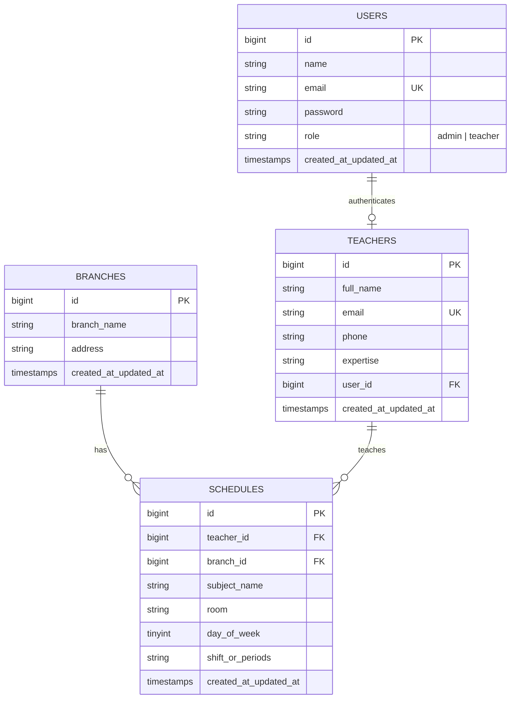

# 🎓 HUIT Schedule Hub
> **Hệ thống Quản lý và Phân lịch Giảng dạy Đa Cơ sở Thông minh**  
> *Đồ án thực hành môn Công nghệ phần mềm / Mã nguồn mở - Trường Đại học Công Thương TP.HCM (HUIT)*

[](https://php.net)
[](https://laravel.com)
[](LICENSE)
[](.github/workflows/ci.yml)

---

## 📌 Giới Thiệu Dự Án

Trong môi trường giáo dục đại học, giảng viên thường phải di chuyển giảng dạy giữa nhiều cơ sở khác nhau (như **Cơ sở chính tại Tân Phú**, cơ sở chế biến, xưởng thực hành công nghệ, hoặc trung tâm liên kết Quận 1). 

**HUIT Schedule Hub** được thiết kế nhằm giải quyết bài toán:
1. **Phân lịch theo tiết trống & tối ưu hóa di chuyển**: Tự động phát hiện khoảng trống chết, chống trùng lịch 100%, và ưu tiên xếp lịch cùng cơ sở trong ngày để giảm thiểu thời gian di chuyển giữa các cơ sở cho giảng viên.
2. **Gợi ý giảng viên thông minh (Smart Recommendation)**: Phân tích sự tương đồng chuyên môn giữa tên học phần và chuyên môn của giảng viên, kết hợp trạng thái lịch trống và địa điểm dạy trong ngày.
3. **Cổng thông tin Giảng viên (Teacher Portal)**: Giúp giảng viên tra cứu lịch dạy cá nhân theo tuần/danh sách, định vị phòng học và dẫn đường đến từng cơ sở qua Google Maps.
4. **Trang tổng quan & Biểu đồ phân bổ**: Lọc nhanh theo cơ sở, giảng viên, hiển thị biểu đồ phân bổ thời gian giảng dạy và ma trận tiết trống trực quan.

---

## 🛠️ Công Nghệ & Thư Viện Sử Dụng

- **Backend**: PHP 8.3, Laravel Framework.
- **Database**: MySQL / MariaDB (Database: `huit_db` hoặc `huit-schedule`).
- **Gói mã nguồn mở qua Packagist**:
  - `vlucas/phpdotenv`: Quản lý an toàn biến môi trường kết nối database.
  - `fakerphp/faker`: Giả lập dữ liệu danh sách giảng viên, tiết trống và thời khóa biểu.
- **Frontend & UI/UX**: Bootstrap 5.3, FontAwesome 6, Google Fonts Plus Jakarta Sans, Chart.js.
- **CI/CD**: GitHub Actions workflow tự động kiểm tra lỗi cú pháp PHP (`php -l`) và chạy test suite khi push code.

---

## 🚀 Hướng Dẫn Cài Đặt Chi Tiết

### 1. Yêu cầu hệ thống
- **Hệ điều hành**: Windows (khuyến nghị chạy trên **Laragon**) hoặc Linux/macOS.
- **PHP**: >= 8.3
- **Composer**: >= 2.0
- **MySQL / MariaDB**: >= 8.0 (hoặc MariaDB 10.4+)

---

### 2. Khởi tạo dự án và cài đặt Composer Packages

Mở terminal trong thư mục `C:\laragon\www\huit-schedule` (hoặc thư mục làm việc của bạn):

```bash
# 1. Di chuyển vào thư mục dự án
cd huit-schedule

# 2. Cài đặt các thư viện phụ thuộc qua Composer
composer install
```

---

### 3. Cấu hình biến môi trường (`.env`)

Sao chép file `.env.example` thành `.env`:

```bash
# Windows PowerShell
copy .env.example .env

# Hoặc Linux/macOS
cp .env.example .env
```

Mở file `.env` và kiểm tra cấu hình kết nối Database:

```env
APP_NAME="HUIT Schedule Hub"
APP_ENV=local
APP_KEY=
APP_DEBUG=true
APP_URL=http://huit-schedule.test

# Cấu hình kết nối MySQL / HeidiSQL
DB_CONNECTION=mysql
DB_HOST=127.0.0.1
DB_PORT=3306
DB_DATABASE=huit_db
DB_USERNAME=root
DB_PASSWORD=
```

Sau đó tạo Application Key:

```bash
php artisan key:generate
```

---

### 4. Hướng dẫn Khởi tạo Dữ liệu (2 Cách)

#### 👉 Cách 1: Import file SQL mẫu (`huit_db.sql`) có sẵn

Dự án đã đóng gói sẵn file SQL mẫu chứa đầy đủ cấu trúc bảng và dữ liệu mẫu thực tế của HUIT:
- Đường dẫn file: `huit_db.sql` (hoặc `database/huit_db.sql`).

**Thao tác import:**
1. **Qua HeidiSQL / phpMyAdmin**:
   - Mở HeidiSQL hoặc phpMyAdmin (trên Laragon: bấm chuột phải vào Laragon -> *MySQL* -> *HeidiSQL*).
   - Tạo Database mới tên `huit_db` (Collation: `utf8mb4_unicode_ci`).
   - Chọn database `huit_db` -> bấm menu **File** -> **Load SQL file...** -> chọn file `huit_db.sql` -> bấm **F9** để thực thi.
2. **Qua Command Line (CLI)**:
   ```bash
   # Tạo database nếu chưa có
   mysql -u root -e "CREATE DATABASE IF NOT EXISTS huit_db CHARACTER SET utf8mb4 COLLATE utf8mb4_unicode_ci;"

   # Import file SQL mẫu
   mysql -u root huit_db < huit_db.sql
   ```

#### 👉 Cách 2: Chạy Migration và Seeder tự động của Laravel

```bash
php artisan migrate --force
php artisan db:seed
```

---

### 5. Cấu hình Virtual Host trên Laragon

Để truy cập web app với tên miền cục bộ [http://huit-schedule.test](http://huit-schedule.test):

1. Đặt thư mục dự án hoặc tạo liên kết (Junction/Symlink) tại `C:\laragon\www\huit-schedule`.
2. Khởi động lại Laragon (hoặc nhấn chuột phải -> *Apache* -> *Reload*).
3. Laragon sẽ tự động nhận diện và trỏ Virtual Host `http://huit-schedule.test` về thư mục `public/`.
4. Hoặc chạy máy chủ phát triển nội bộ:
   ```bash
   php artisan serve
   # Truy cập tại: http://127.0.0.1:8000
   ```

---

## 🔑 Tài Khoản Trải Nghiệm Mẫu

Hệ thống đã chuẩn bị sẵn tài khoản demo với phân quyền chi tiết:

| Vai trò | Email đăng nhập | Mật khẩu | Quyền hạn |
| :--- | :--- | :--- | :--- |
| **Quản trị viên (Admin)** | `admin@huit.edu.vn` | `admin123` | Toàn quyền CRUD lịch dạy, cơ sở, giảng viên, xem ma trận tiết trống và gợi ý thông minh |
| **Giảng viên Web** | `nguyenvanan@huit.edu.vn` | `password` | Xem thời khóa biểu cá nhân TS. Nguyễn Văn An, định vị cơ sở Tân Phú, Q1 |
| **Giảng viên AI** | `lehoangcuong@huit.edu.vn` | `password` | Xem thời khóa biểu cá nhân PGS.TS. Lê Hoàng Cường (AI/Data) |
| **Giảng viên Mạng** | `phamminhdung@huit.edu.vn` | `password` | Xem thời khóa biểu cá nhân ThS. Phạm Minh Dũng (Cơ sở Nguyễn Đỗ Cung) |

> 💡 *Trang đăng nhập có sẵn các nút bấm một chạm để tự động điền tài khoản mẫu rất tiện lợi khi chấm điểm.*

---

## 📊 Cấu Trúc Cơ Sở Dữ Liệu (`huit_db`)

Hệ thống được thiết kế chuẩn mực quan hệ trên MySQL:



---

## 🤖 Tự Động Hóa CI/CD (GitHub Actions)

Dự án tích hợp workflow kiểm tra mã nguồn tự động tại `.github/workflows/ci.yml`:
- Tự động chạy mỗi khi có commit được `git push` hoặc `pull_request` lên nhánh `main`.
- Thực hiện kiểm tra lỗi cú pháp PHP trên toàn bộ mã nguồn bằng lệnh:
  ```bash
  php -l <filename>
  ```
- Tự động cài đặt dependencies và chạy bộ test suite (`php artisan test`) để đảm bảo hệ thống không bị lỗi hồi quy (regression bugs).

---

## 📄 Bản Quyền & Giấy Phép (License)

Dự án được phân phối dưới giấy phép mã nguồn mở **[MIT License](LICENSE)**.
© 2026 **Vu Thien Long (MSSV: 2001230456)** - Trường Đại học Công Thương TP.HCM (HUIT).
